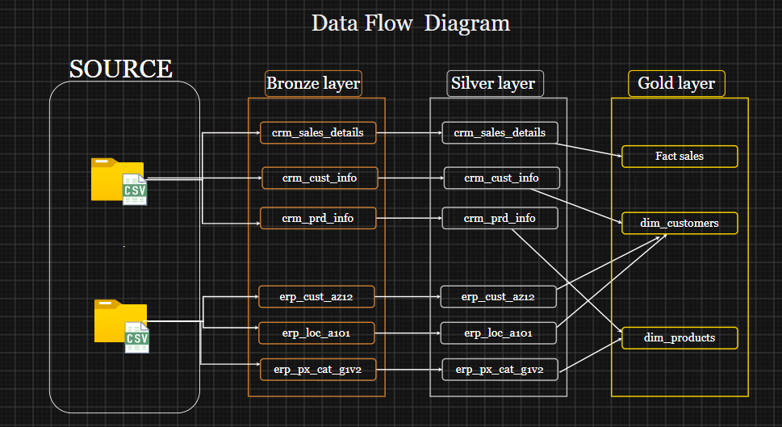
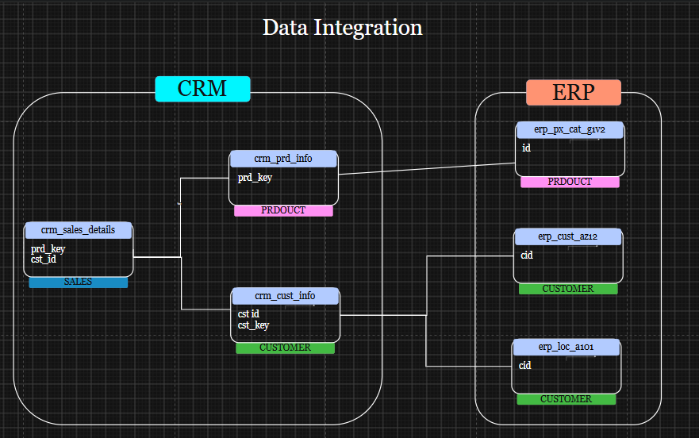
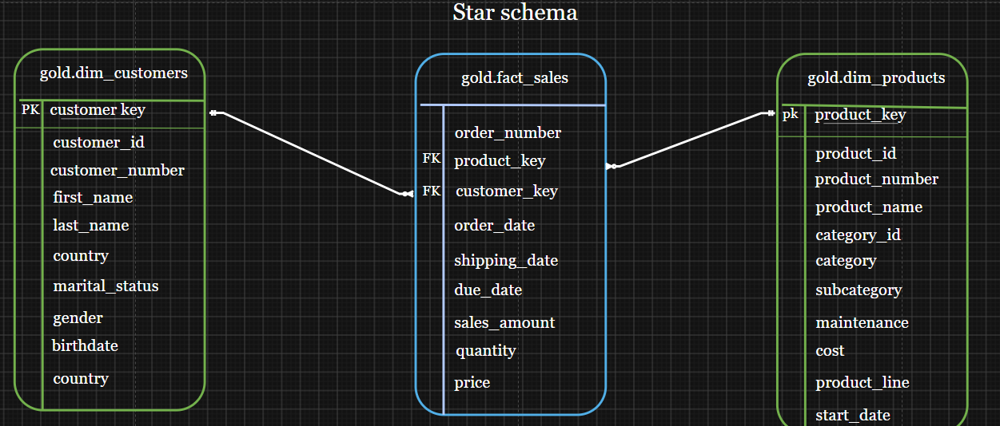

# SQL Data Warehouse Project

An end-to-end data warehouse built on SQL Server. It loads raw CSV files from two source systems (CRM and ERP), cleans and standardizes them, and exposes a star schema ready for reporting and analysis.

The project follows the **Medallion Architecture** (Bronze, Silver, Gold).

---

## Table of Contents

- [Project Overview](#project-overview)
- [Architecture](#architecture)
- [Data Sources](#data-sources)
- [Repository Structure](#repository-structure)
- [Tech Stack](#tech-stack)
- [How to Run](#how-to-run)
- [Data Integration](#data-integration)
- [Transformations](#transformations)
- [Gold Layer Data Model](#gold-layer-data-model)
- [Data Quality Checks](#data-quality-checks)
- [Author](#author)

---

## Project Overview

The goal is to consolidate sales data that is spread across two systems into a single, clean, analytics-ready model.

| Item | Details |
| --- | --- |
| Database | `datawarehouse` (SQL Server) |
| Sources | 2 systems (CRM and ERP), 6 CSV files |
| Load type | Full load (truncate and insert) |
| Output | Star schema: 2 dimensions and 1 fact table, exposed as views |

---

## Architecture



| Layer | Purpose | Object type | Transformations |
| --- | --- | --- | --- |
| Bronze | Raw data, loaded as-is from the CSV files | Tables | None |
| Silver | Cleaned and standardized data | Tables | Cleaning, standardization, deduplication, derived columns |
| Gold | Business-ready data modeled as a star schema | Views | Joins and business logic |

---

## Data Sources

Two source systems provide the data as CSV files.

**CRM**

| File | Description |
| --- | --- |
| `cust_info.csv` | Customer information |
| `prd_info.csv` | Product information and history |
| `sales_details.csv` | Sales transactions |

**ERP**

| File | Description |
| --- | --- |
| `CUST_AZ12.csv` | Additional customer data (birth date, gender) |
| `LOC_A101.csv` | Customer country |
| `PX_CAT_G1V2.csv` | Product categories and subcategories |

---

## Repository Structure

```
sql-data-warehouse/
│
├── README.md
│
├── datasets/
│   ├── source_crm/
│   │   ├── cust_info.csv
│   │   ├── prd_info.csv
│   │   └── sales_details.csv
│   └── source_erp/
│       ├── CUST_AZ12.csv
│       ├── LOC_A101.csv
│       └── PX_CAT_G1V2.csv
│
├── docs/
│   ├── data_flow_diagram.png
│   ├── data_integration.png
│   └── star_schema.png
│
└── scripts/
    ├── init_database.sql
    ├── bronze/
    │   ├── ddl_bronze.sql
    │   └── proc_load_bronze.sql
    ├── silver/
    │   ├── ddl_silver.sql
    │   └── proc_load_silver.sql
    └── gold/
        └── ddl_gold.sql
```

---

## Tech Stack

- SQL Server
- SQL Server Management Studio (SSMS)
- T-SQL (stored procedures, views, window functions)

---

## How to Run

### Prerequisites

- SQL Server and SSMS installed
- The `datasets/` folder available on the machine running SQL Server (the `BULK INSERT` command reads files from the server's file system)

### Steps

Run the scripts in this order:

| Step | Script | What it does |
| --- | --- | --- |
| 1 | `scripts/init_database.sql` | Creates the `datawarehouse` database and the `bronze`, `silver`, and `gold` schemas |
| 2 | `scripts/bronze/ddl_bronze.sql` | Creates the bronze tables |
| 3 | `scripts/bronze/proc_load_bronze.sql` | Creates the load procedure for the bronze layer |
| 4 | `scripts/silver/ddl_silver.sql` | Creates the silver tables |
| 5 | `scripts/silver/proc_load_silver.sql` | Creates the load procedure for the silver layer |
| 6 | `scripts/gold/ddl_gold.sql` | Creates the gold views |

Then load the data:

```sql
EXEC bronze.load_bronze;
EXEC silver.load_silver;
```

Before running `bronze.load_bronze`, update the file paths inside `proc_load_bronze.sql` so they point to where the `datasets/` folder is located on your machine.

Each procedure prints the table being loaded, the load duration per table, and the total duration. If an error occurs, the error message, number, and state are printed.

### Verify the result

```sql
SELECT TOP 10 * FROM gold.fact_sales;
SELECT TOP 10 * FROM gold.dim_customers;
SELECT TOP 10 * FROM gold.dim_products;
```

---

## Data Integration

The CRM and ERP tables are connected through the following keys.



| From | To | Join key |
| --- | --- | --- |
| `crm_sales_details` | `crm_prd_inf` | `sls_prd_key` = `prd_key` |
| `crm_sales_details` | `crm_cust_info` | `sls_cust_id` = `cst_id` |
| `crm_cust_info` | `erp_cust_az12` | `cst_key` = `cid` |
| `crm_cust_info` | `erp_loc_a101` | `cst_key` = `cid` |
| `crm_prd_inf` | `erp_px_cat_g1v2` | `cat_id` = `id` |

---

## Transformations

Main cleaning and standardization rules applied when loading the silver layer.

| Table | Transformation |
| --- | --- |
| `crm_cust_info` | Keeps only the latest record per customer (by create date); removes rows without a customer ID; trims names; converts marital status and gender codes to readable values (`Single`, `Married`, `Male`, `Female`); uses `n/a` for unknown values |
| `crm_prd_inf` | Splits the product key into `cat_id` and `prd_key`; replaces null cost with 0; converts product line codes to full names (`Mountain`, `Road`, `Touring`, `Other Sales`); calculates the end date as one day before the next start date |
| `crm_sales_details` | Converts date columns stored as integers (for example `20240115`) to `DATE`; invalid dates become `NULL`; recalculates sales and price when they are missing, zero, negative, or inconsistent with `quantity * price` |
| `erp_cust_az12` | Removes the `NAS` prefix from customer IDs; standardizes gender values |
| `erp_loc_a101` | Removes hyphens from customer IDs; converts country codes to full names (`DE` to `Germany`, `US` and `USA` to `United States`); uses `n/a` for empty values |
| `erp_px_cat_g1v2` | Loaded without changes |

---

## Gold Layer Data Model

The gold layer is a star schema with one fact table and two dimensions.



| View | Type | Description |
| --- | --- | --- |
| `gold.dim_customers` | Dimension | One row per customer. Combines CRM and ERP data. Gender comes from the CRM first, with the ERP value used as a fallback. |
| `gold.dim_products` | Dimension | One row per current product, enriched with category, subcategory, and maintenance data. Historical versions are excluded. |
| `gold.fact_sales` | Fact | One row per sales line, linked to both dimensions through surrogate keys. |

Surrogate keys (`customer_key`, `product_key`) are generated with `ROW_NUMBER()`.

---

## Data Quality Checks

After loading the gold layer, run this query. It should return no rows, which means every sale is linked to a customer and a product:

```sql
SELECT *
FROM gold.fact_sales
WHERE customer_key IS NULL
   OR product_key IS NULL;
```

---

## Author

**Alhassan**
Business Informatics, Benha University

- GitHub: https://github.com/your-username
- LinkedIn: https://www.linkedin.com/in/your-profile
